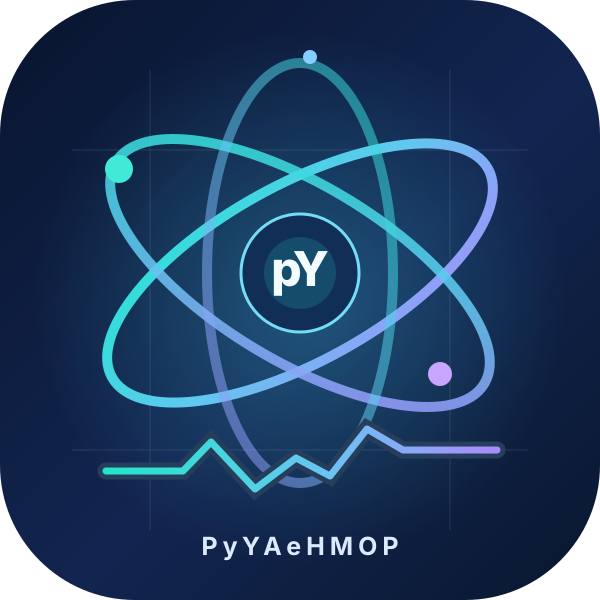
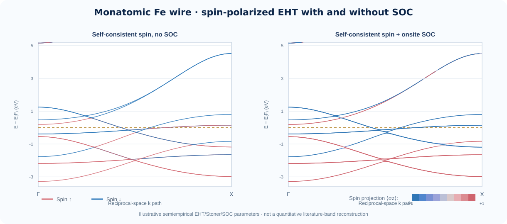

## Download and run: complete example catalog

**Essential transport reading:** [How to define electrode repeat vectors — derivations, diagrams and cutoff checks](docs/lead-repeats.md).

**[All examples — XYZ and CIF input files side by side](examples/README.md)** · **[Complete illustrated PDF](docs/PyYAeHMOP_v2_tutorial.pdf)**

Direct examples (from the repository root after installation):

```bash
python -m pyaehmop examples/transport/graphene.transport.job
python -m pyaehmop examples/transport/graphene_cif.transport.job
python -m pyaehmop examples/devices/pristine.device.job
python -m pyaehmop examples/devices/pristine_cif.device.job
python -m pyaehmop examples/devices/graphene_mos2.device.job
python -m pyaehmop examples/devices/graphene_mos2_cif.device.job
```

Both formats run directly. Explicit device CIFs use a common ordered P1 box and coordinate frame (no auxiliary JSON); physical lead repeat vectors remain in the job. See [CIF/XYZ guide](docs/transport-cif.md).

**Start here:** [Illustrated PDF tutorial](docs/PyYAeHMOP_v2_tutorial.pdf) · [Runnable examples](examples/tutorials/README.md) · [Installation](docs/installation.md) · [Device geometry](docs/device-geometry.md) · [Parameter sources](docs/parameters.md)

> **Version 2 experimental device transport.** This independent repository preserves PyYAeHMOP 0.4.0 and adds explicit left/right electrodes, independent scattering region, frozen collinear spin and atomic SOC. See [device input and examples](examples/devices/README.md).

<p align="center">
  
</p>
<p align="center">
  
</p>

<p align="center">
  <a href="#quick-start">Quick start</a> ·
  <a href="#what-you-can-calculate">Features</a> ·
  <a href="#input-formats">Input formats</a> ·
  <a href="#scientific-background">Theory</a> ·
  <a href="#validation-and-examples">Validation</a> ·
  <a href="docs/installation.md">Installation guide</a>
</p>

<p align="center">
  
  
  
  
</p>

> **An independent, YAeHMOP-inspired Python implementation of Extended Hückel Theory (EHT)** with parallel CPU calculations, molecular and periodic electronic structure, an accessible input format, and experimental self-consistent spin polarization and spin–orbit coupling (SOC).

**PyYAeHMOP** is more than a graphical wrapper or a language translation. It implements the electronic-structure calculations in Python/NumPy/SciPy and extends the workflow with convenient XYZ/CIF/ASE inputs. **It does not require the original compiled YAeHMOP executable.**

**Independence and attribution:** PyYAeHMOP is an **unofficial, independently developed research project**, not a release of or an officially supported interface to YAeHMOP. The original YAeHMOP project and parameter data are credited in [Third-party notices](THIRD_PARTY_NOTICES.md).

---

## At a glance

| Capability | PyYAeHMOP |
|---|---|
| Molecular Extended Hückel | Energy levels, occupations, orbital coefficients, HOMO–LUMO gaps |
| Periodic Extended Hückel | Bloch Hamiltonians, k-point integration, band structures |
| Electronic analysis | Mulliken populations/charges, Gaussian-broadened DOS, COOP/COHP |
| Orbital analysis | Fragment molecular orbitals (FMO) for molecular systems |
| Spin polarization | Self-consistent *collinear* Stoner exchange, up/down bands |
| Spin–orbit coupling | Onsite atomic `L·S` in a spinor generalized eigenproblem |
| Spin + SOC | Combined collinear-z Stoner SCF and spin-projected bands/DOS |
| Parallel computing | CPU processes for independent overlaps and k-point calculations |
| Input | Native YAeHMOP subset, XYZ, CIF, ASE, user-supplied EHT parameters |
| User experience | CLI, compact human-readable jobs |

**Scope:** Spin and SOC are **experimental semiempirical extensions**, not fully noncollinear spin-DFT. EHT total electronic energies are not DFT total energies; physical predictions require material-specific parameter validation and convergence studies.

## Quick start

### Option A · pip, directly from GitHub

Install the Python engine directly from this source repository:

```bash
python3 -m pip install "git+https://github.com/tromer-unb/PyYAeHMOP_version2.git"
```

For structure readers and plotting, clone the repository and install its optional dependencies:

```bash
git clone https://github.com/tromer-unb/PyYAeHMOP_version2.git
cd PyYAeHMOP_version2
python3 -m pip install -e ".[all]"
```

> This is a **GitHub-source installation**, not a claim that `pyaehmop` is already published on PyPI.

### Option B · Conda / conda-forge dependencies

```bash
git clone https://github.com/tromer-unb/PyYAeHMOP_version2.git
cd PyYAeHMOP_version2
conda env create -f environment.yml
conda activate pyaehmop
```

The environment installs scientific dependencies from conda-forge and the local PyYAeHMOP project through pip. **No standalone PyYAeHMOP conda-forge package is claimed.** See [installation & troubleshooting](docs/installation.md).

### First calculation · water molecule

```bash
python -m pyaehmop pyaehmop/examples_friendly/water_full.job
```

This example reads an XYZ molecular geometry and calculates electronic properties through a **human-friendly input**. A minimal new job looks like:

```ini
xyz
water.xyz

parameters = default
calculations = energy, charges, dos
workers = 2
dos_sigma = 0.15
outputs = json, csv, png
plots = yes
output = results/water
```

The first two lines specify the structure **format** and **file**. Relative paths are resolved against the input file's directory.

### First periodic calculation · diamond

```bash
python -m pyaehmop pyaehmop/examples_friendly/diamond_cif.job
```

This reads a CIF structure and evaluates bands/DOS with the example's selected EHT parameters and k-point settings.

## What you can calculate

### Electronic bands, density of states and charge analysis

```ini
cif
diamond_primitive.cif

calculations = energy, charges, bands, dos
parameters = C 6 4 2 1.71 -21.4 2 1.625 -11.4
kmesh = 4 4 4
band_path = auto
divisions = 80
workers = 4
cutoff = 11
outputs = json, csv, png
plots = yes
```

Periodic calculations use a generalized eigenvalue problem with nonorthogonal atomic orbitals and Bloch-summed real-space overlaps. Band-path gaps are **path-sampled** and may differ from the fundamental gap.

### Self-consistent spin polarization with spin–orbit coupling

<p align="center">
  
</p>

```ini
ase
Fe_wire.extxyz

parameters = default
spin = yes
soc = yes

stoner_fe_d = 0.88
soc_fe_d = 0.06
initial_moment = 2.5
mixing = 0.3
temperature_ev = 0.025
tolerance = 0.00001
max_iter = 140

kmesh = 24
band_path = G:0,0,0; X:0.5,0,0
divisions = 75
images = 3
cutoff = 5.6
quadrature = 20 18 12
workers = 2
```

Set `spin = yes, soc = no` for spin-only, or `spin = no, soc = yes` for SOC-only. With SOC, pure ↑/↓ channels generally do **not** exist: the spin/SOC plotting code colors bands by their spin expectation value `⟨σz⟩`.

```bash
python -m pyaehmop.SPIN_TEST --demo
```

The Fe wire is a **demonstration based on literature geometry**, not a quantitatively reproduced or independently calibrated published band structure. See [spin/SOC theory and limitations](docs/theory.md#spin-polarization-and-spinorbit-coupling).

### External YAeHMOP parameters

```ini
parameters = default
```

or:

```ini
parameters = custom_yaehmop.txt
```

The file can contain a classic YAeHMOP `PARAMETERS` block or a native `eht_parms.dat`-style table, including double-zeta coefficients. Parameters may be loaded in either ordinary EHT jobs or spin/SOC jobs. Full details: [input reference](docs/input-formats.md#eht-parameter-selection).

## Input formats

| First line | Second line | Typical application |
|---|---|---|
| `yaehmop` | Native YAeHMOP input path | Existing EHT examples, geometry, lattice, FMO |
| `xyz` | Cartesian XYZ path | Molecules and Mulliken charges |
| `cif` | Crystallographic CIF path | Crystal bands and DOS |
| `ase` | ASE-readable geometry path | POSCAR, extended XYZ, supported formats |

There is no need to convert every structure into YAeHMOP syntax. Choose tasks with `calculations = energy, charges, bands, dos`. **Native YAeHMOP input keywords remain unchanged** for format compatibility.

[All input keywords and ready-to-copy jobs](docs/input-formats.md) · [Bundled example files](pyaehmop/examples_friendly) · [Spin examples](pyaehmop/SPIN_TEST/examples)

## Validation and examples

The **English 0.4.0 implementation** was checked locally (not on GitHub Actions) with **74 passing automated tests** across the EHT, input/GUI/parameter and experimental spin/SOC suites. A separate regression compared **10,314 numerical values** with the preceding implementation; the maximum observed difference was **0** for those cases.

| Example | Selected reference result | Context |
|---|---:|---|
| XeF₄ molecule | Electronic energy: **−812.312885 eV** | EHT levels, Mulliken and fragment properties |
| H–Fe molecule | Electronic energy: **−118.442589 eV** | Molecular d-shell and extended basis |
| Diamond | Sampled band-path gap: **4.960525 eV** | 81-point example path; **not** a converged fundamental gap |
| Water (XYZ) | Electronic energy: **−162.541764 eV** | Friendly input; default vs external parameters |
| Fe wire, Stoner spin only | z moment: **2.000056 μB/Fe** | Collinear spin SCF |
| Fe wire, Stoner + SOC | z moment: **1.996872 μB/Fe** | Spinor SOC; spin-projected bands |

These are **model/regression values, not experimental predictions**. Their purpose is to demonstrate numerical reproducibility. See [validation methodology and caveats](docs/validation.md).

Run tests locally if desired:

```bash
python -m unittest discover -s pyaehmop/tests -p "test_*.py" -v
python -m unittest discover -s pyaehmop/SPIN_TEST/tests -p "test_*.py" -v
```

No GitHub Actions calculations have been triggered for this publication.

## Scientific background

PyYAeHMOP implements the semiempirical **Extended Hückel Theory**. The molecular or Bloch eigenproblem is

```math
H(\mathbf{k})\, C(\mathbf{k}) = S(\mathbf{k})\,C(\mathbf{k})\,E(\mathbf{k}),
```

where `S` is the overlap matrix of the nonorthogonal Slater-type atomic orbitals. The onsite terms are parameterized atomic orbital energies, and the off-diagonal Hamiltonian terms are derived from overlap-weighted EHT coupling.

For periodic systems,

```math
S(\mathbf{k})=\sum_{\mathbf R}S(\mathbf R)\,e^{2\pi i\mathbf k\cdot\mathbf R}.
```

The experimental magnetic extension adds a self-consistent Stoner exchange potential and onsite atomic SOC `H_SOC = ξ L·S`. The exchange is treated in a **constrained collinear-z** scheme even when SOC is enabled. See the detailed [theory and implementation notes](docs/theory.md).

**Limitations that matter:** EHT is a semiempirical method; the k-grid, overlap cutoffs, finite-temperature occupations and parameter choices affect the results. The magnetism implementation is **not** fully noncollinear SCF, SOC is onsite rather than a fully relativistic two-center operator, and selected original YAeHMOP features remain unsupported. The documentation lists these boundaries explicitly.

## Project structure

```text
PyYAeHMOP/
├── assets/                 # Vector logo, banner and curated example figures
├── docs/                   # Installation, theory, inputs and validation
├── pyaehmop/
│   ├── basis.py            # Atomic Slater orbital basis
│   ├── overlap.py          # Numerical overlap integration
│   ├── engine.py           # EHT Hamiltonian, diagonalization and periodic bands
│   ├── friendly.py         # Human-readable job files
│   ├── structure_io.py     # XYZ, CIF and ASE
│   ├── parameter_files.py  # External YAeHMOP parameters
│   ├── SPIN_TEST/          # Self-consistent Stoner and SOC research module
│   ├── examples_friendly/  # Tested molecular / periodic inputs
│   ├── inputs/             # Original-format input examples
│   └── tests/              # Local automated regression tests
├── scripts/                # Portable launch scripts
├── environment.yml         # Conda environment
└── pyproject.toml          # pip-installable project
```

[Architecture & parallel execution](docs/architecture.md) · [Development guide](CONTRIBUTING.md)

## Cite, credit and contribute

If you use PyYAeHMOP in scientific work, cite this repository (see [`CITATION.cff`](CITATION.cff)) **and** the underlying methodological literature. The original YAeHMOP implementation was developed by Greg Landrum and collaborators; PyYAeHMOP is not affiliated with or endorsed by that project.

- Hoffmann, R. *An Extended Hückel Theory. I. Hydrocarbons.* **J. Chem. Phys.** 39, 1397 (1963). DOI: [10.1063/1.1734456](https://doi.org/10.1063/1.1734456).
- Original [YAeHMOP repository](https://github.com/greglandrum/yaehmop) and its bundled parameter data.
- Autès *et al.* *Magnetism of iron: from the bulk to the monatomic wire.* **J. Phys.: Condens. Matter** 18, 6785 (2006). DOI: [10.1088/0953-8984/18/29/018](https://doi.org/10.1088/0953-8984/18/29/018).

Contributions, reproducible issues and scientific discussion are welcome. Read [CONTRIBUTING.md](CONTRIBUTING.md), [CODE_OF_CONDUCT.md](CODE_OF_CONDUCT.md) and the [research validation notes](docs/validation.md) first.

### Licensing

The original new Python project is released under the [MIT License](LICENSE). Reused YAeHMOP parameter material carries its **original BSD-style copyright notice** in [`pyaehmop/LICENSE.txt`](pyaehmop/LICENSE.txt); see [THIRD_PARTY_NOTICES.md](THIRD_PARTY_NOTICES.md). Do not interpret the repository license as overriding third-party attribution requirements.

---

<p align="center"><strong>Built for reproducible extended Hückel research — from molecules to crystals, through reproducible command-line inputs.</strong></p>

## Experimental quantum transport (EHT-NEGF)

See the [graphene transport benchmark](examples/transport/README.md) for the standalone nonorthogonal NEGF module, frozen BandFit parameters, archived comparison with TranSIESTA, references and local run instructions. No automatic calculations are triggered.

## Reproduce every example

Start with the [complete runnable tutorial index](examples/tutorials/README.md): molecular and periodic inputs, spin/SOC, all six BandFit models, fifteen independent-device examples, PBS scripts and archived numerical references.

## CIF alternatives for transport

[CIF and XYZ transport examples](docs/transport-cif.md) explains the paired uniform inputs and how to convert the three-region CIF sources for all explicit device examples. The original XYZ examples remain unchanged.
