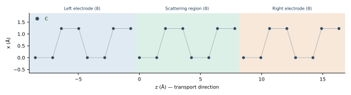
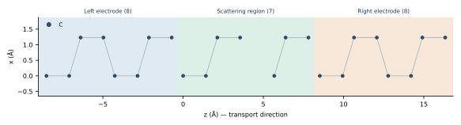
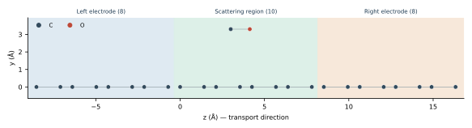
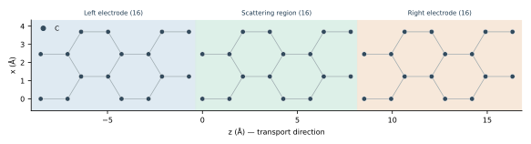
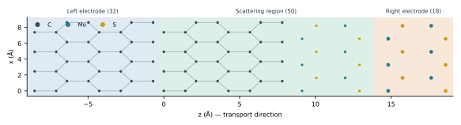
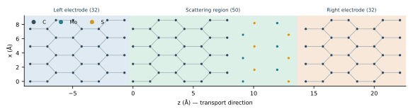

# Building a two-terminal device

[PDF tutorial](PyYAeHMOP_v2_tutorial.pdf) · [Example index](../examples/tutorials/README.md)

## Choose the correct solver

- `.transport.job`: a uniform periodic material. Specify one cell, its
  lattice vectors and the zero-based transport-axis index. The program
  generates identical electrodes and a central principal layer automatically.
- `.device.job`: three explicit Cartesian XYZ files. Each contact may have
  its own species, atom count and longitudinal repeat; the device may be
  defective, molecular or heterogeneous. These are independent geometries,
  NOT three independent energy zeros. All use a common parameter convention
  and a shared transverse lattice. No geometry relaxation is performed.

## Coordinate convention (actual pristine graphene input)

The four-carbon rectangular unit cell has x period 2.459512 Å and z period
4.26 Å. The device example uses TWO cells per contact layer (8 atoms), with
a longitudinal repeat of 8.52 Å. The sheet lies in the x-z plane; y is
nonperiodic. Left, device and right files contain the nearest principal
layers in a single global Cartesian frame:

| File | Carbon atoms | z interval (Å) | Physical role |
|---|---:|---|---|
| left.xyz | 8 | -8.52 to -0.71 | nearest layer of semi-infinite left electrode |
| pristine.xyz | 8 | 0 to 7.81 | finite scattering region |
| right.xyz | 8 | 8.52 to 16.33 | nearest layer of semi-infinite right electrode |

For pristine graphene, the LEFT AND RIGHT ELECTRODES ARE THE SAME MATERIAL,
same lattice and same basis; the atoms are translated, not chemically
different. With device positions d, left positions are d - (0,0,8.52)
and right positions are d + (0,0,8.52). Thus R = L + (0,0,17.04) for this
particular one-layer device. Do not pass the same unshifted XYZ twice:
the parser expects absolute positions, not independent local origins.
Both left_repeat and right_repeat point in the positive transport direction.
The code extends the left electrode towards negative multiples of its
repeat and the right electrode towards positive multiples of its repeat.

    electrode_left = left.xyz
    scattering_region = pristine.xyz
    electrode_right = right.xyz
    transverse_vectors = 2.459512 0 0
    left_repeat = 0 0 8.52
    right_repeat = 0 0 8.52

The eight-atom contacts are principal layers, not finite electrodes.
The common transverse period makes the sheet infinite across x. A one-row
drawing shows only one transverse repeat, not a nanoribbon. For a ribbon
use finite-width coordinates and no transverse vectors (blank k mesh).
For transport in x, build contact layers ordered along x and use z
as the common transverse vector; see [graphene_x](../examples/tutorials/graphene_x/README.md).
For arbitrary directions, choose an appropriate crystallographic supercell,
not simply a different label for an unchanged geometry.

## Prepare a new device step by step

1. Obtain a relaxed or otherwise justified bulk/lead structure and a
   physically appropriate EHT parameter table. Choose a common transverse
   repeat for both contacts and central region. Heterojunctions may require
   commensuration, strain and interface relaxation.
2. Repeat the bulk cells along transport to form principal layers.
   Atoms must be ordered along the transport normal as L, D, R. Include
   enough unmodified contact material inside D to buffer the perturbation.
3. Place all three files in one coordinate system. The supplied left/right
   XYZs are the nearest electrode layers. The program computes rectangular
   couplings from actual positions; it does not align or translate them.
4. Choose cutoff and quadrature. The code conservatively rejects geometries
   for which a second-neighbor lead layer, deeper lead-device coupling or
   direct L-R coupling cannot be ruled out by the projected distances.
   Increase lead thickness and/or device length before increasing cutoff.
   The quick examples use 4.5 Å (3.5 Å for heterojunctions), not the 11 Å
   benchmark cutoff. Converge the cutoff and overlap quadrature separately.
5. Set a common absolute energy reference in eV; plot E-Eref. It is not
   automatically the Fermi level of an arbitrary device. Isolated bulk
   band fits can differ by arbitrary energy offsets. A heterojunction needs
   physically validated relative alignment and interface couplings.
6. Specify transverse_kpoints (one integer per transverse vector), eta,
   energy range, energy_points and workers. For a 1D device, omit transverse
   vectors and leave transverse_kpoints blank. The energy grid must cover
   the bias window and 20 kBT on each side if I(V) is requested.
7. Run the pristine counterpart first and check numerical convergence.
   Then add a defect or adsorbate only to D. If a transverse direction
   is periodic, the defect is repeated along it. Increase transverse
   separation and converge the observable before claiming an isolated defect.

## Example geometry atlas

All figures use the checked-in XYZ coordinates (one transverse repeat).
Projection is in the x-z plane except the nanoribbon and adsorbate
also show the relevant width/height; the geometry files remain authoritative.

## Scope

The two-terminal device solver is coherent, elastic EHT-NEGF with frozen
Hamiltonians. It does not solve Poisson, open-system magnetic SCF or
self-consistent finite-bias charge transfer. A physical prediction needs
validated geometry, parameters, energy alignment and numerical convergence.

## CIF alternatives for transport

[CIF source files and conversion](transport-cif.md#3-explicit-devices-cif-source-files-xyz-solver-input) explains the paired uniform inputs and how to convert the three-region CIF sources for all explicit device examples. The original XYZ examples remain unchanged.
