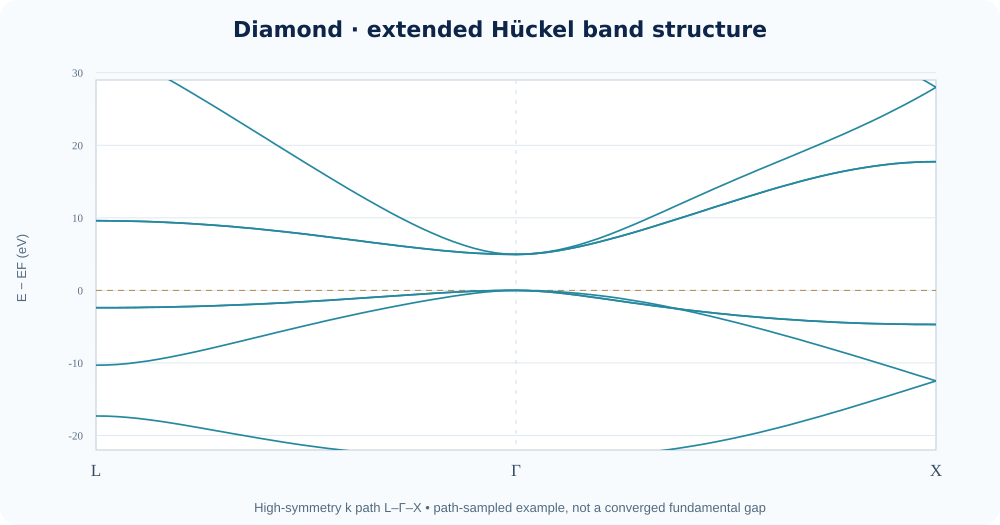
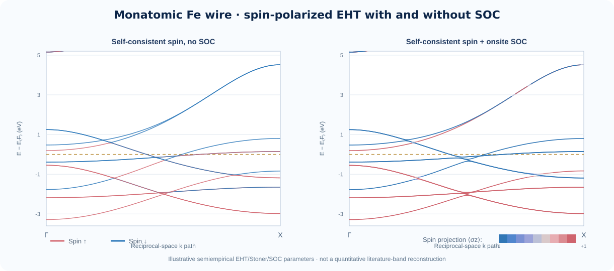
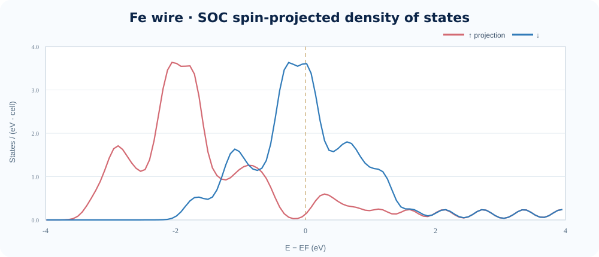

# Tested examples and expected numerical results

[← Overview](../README.md) · [Input recipes](input-formats.md) · [Validation](validation.md)

The repository includes source input files used in the **local 0.4.0 validation**. These examples provide reproducible baseline results, **not experimental reference data**.

Run commands from the repository root after installing with `pip install -e ".[gui]"` or activating the Conda environment.

## Molecular examples

### XeF₄: traditional YAeHMOP input

```bash
python -m pyaehmop pyaehmop/inputs/XeF4
```

Checks the EHT molecular spectrum, Mulliken charges and HOMO/LUMO. A representative numerical baseline from the original-format calculation is **−812.312885 eV** for the model electronic energy. The molecule has 20 basis orbitals and 36 valence electrons in the example.

You may also use a two-line friendly wrapper:

```bash
python -m pyaehmop pyaehmop/examples_friendly/xef4_original.job
```

**Caution:** this is an extended Hückel one-electron energy, not an ab initio total molecular energy.

### H–Fe: d-shell molecular test

```bash
python -m pyaehmop pyaehmop/inputs/FeH
```

The reference model electronic energy is approximately **−118.442589 eV**. This example exercises the Fe valence basis and parametrized heteronuclear overlap.

### Water: friendly XYZ and external parameters

```bash
python -m pyaehmop pyaehmop/examples_friendly/water_full.job
python -m pyaehmop pyaehmop/examples_friendly/water_default_parameters.job
python -m pyaehmop pyaehmop/examples_friendly/water_custom_parameters.job
```

The water reference result is **−162.541764 eV** (model electronic energy). The external `water_parameters.txt` supplied in this repository reproduces the default result with matching EHT onsite energies and exponents. Altering those parameters changes the computed levels and charges as expected.

The `water_charges.job` example requests Mulliken charges without a band calculation.

## Periodic examples

### Diamond: native YAeHMOP and CIF

```bash
python -m pyaehmop pyaehmop/inputs/diamond
python -m pyaehmop pyaehmop/examples_friendly/diamond_cif.job
```

The native path example samples **81 k points**, along **L–Γ–X**. A representative path-sampled gap is **4.960525 eV**.



The CIF example uses explicitly specified carbon EHT parameters to reproduce the corresponding convention. The displayed gap is **not a verified experimental gap or a full Brillouin-zone fundamental gap**.

### ASE / VASP POSCAR

A packaged ASE input recipe is at [`diamond_poscar.job`](../pyaehmop/examples_friendly/diamond_poscar.job). Install ASE for these formats. Check that the referenced POSCAR geometry is present and paths are adjusted as needed when you copy a recipe.

## Magnetic examples: monatomic Fe wire

The experimental spin module includes three modes:

```bash
python -m pyaehmop.SPIN_TEST pyaehmop/SPIN_TEST/examples/Fe_wire_spin.spin
python -m pyaehmop.SPIN_TEST pyaehmop/SPIN_TEST/examples/Fe_wire_soc.spin
python -m pyaehmop.SPIN_TEST pyaehmop/SPIN_TEST/examples/Fe_wire_both.spin
```

Or run the complete example suite and plots:

```bash
python -m pyaehmop.SPIN_TEST --demo
```

| Model | Reported z moment for the example |
|---|---:|
| Collinear Stoner, no SOC | 2.000056 μB/Fe |
| SOC only, no Stoner magnetism | ≈ 0 μB/Fe |
| Collinear Stoner + SOC | 1.996872 μB/Fe |





**Interpretation:** In spin-only mode, the eigenstates are pure ↑ and ↓. When SOC is on, color represents the **spin-z expectation** rather than an exact spin quantum number. All curves are original semiempirical calculations and are **not copies or quantitative reconstructions of band diagrams from the cited literature**.

### External native YAeHMOP parameter table with spin+SOC

```bash
python -m pyaehmop.SPIN_TEST \
  pyaehmop/SPIN_TEST/examples/Fe_wire_external_parameters.spin
```

In the local regression, using `parameters = ../../eht_parms.dat` produced **zero numerical difference** in the sampled Fe-wire bands, spin projections, model energy and total moment compared with the bundled default table.

### Molecular SOC: isolated C atom

```bash
python -m pyaehmop.SPIN_TEST pyaehmop/SPIN_TEST/examples/C_atom_both.spin
```

This tests a molecular (nonperiodic) spin+SOC configuration and provides a compact numerical diagnostic for the onsite operator.

## Reproducibility checklist

Before comparing different materials, parameter sets, lattice constants or magnetic configurations, record:

- Source input and EHT parameters, including whether they are custom or bundled defaults.
- Structure (atomic positions and lattice), model mode and spin/SOC strengths.
- STO quadrature, periodic image cutoff, k-point integration mesh and band path.
- Fermi–Dirac broadening, SCF tolerance, number of iterations and final residual.
- CPU worker count, software commit SHA, Python and dependency versions.
- Whether a reported band gap is the path-sampled gap or the true Brillouin-zone minimum.

The original local validation comprised **74 passing tests** and a **10,314-value numerical regression**. Those figures describe finite tested inputs; they are **not** a general proof of convergence or predictive accuracy.
