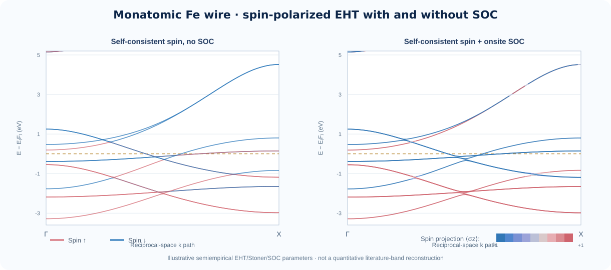
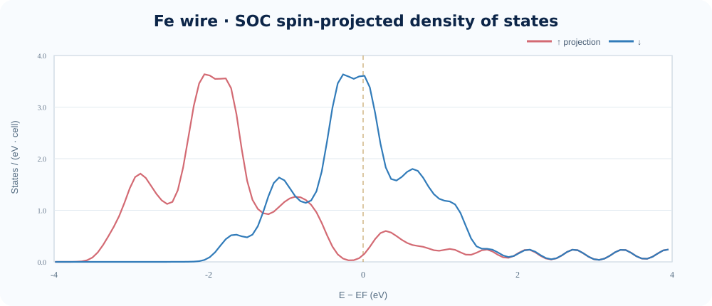

# PyYAeHMOP Studio — Linux desktop GUI

[← Overview](../README.md) · [Installation](installation.md) · [Input recipes](input-formats.md)

PyYAeHMOP Studio is a fully functioning **Tkinter + Matplotlib** application for ordinary EHT and experimental Stoner/SOC calculations. It communicates with the same numerical engine as the CLI.

## Launch

```bash
cd PyYAeHMOP
python -m pip install -e ".[gui]"
python -m pyaehmop.gui
```

Or run `pyaehmop-gui` after installing the package, or `./scripts/launch_gui.sh` from the source checkout.

A Linux desktop display is required. You may need `python3-tk` from your OS package manager, or `tk` from conda-forge. See [Installation](installation.md).

## GUI panels

| Area | Controls / output |
|---|---|
| **Structure & parameters** | Input type and file; `default`, external YAeHMOP file, or an interactive atomic-shell editor |
| **Requested calculations** | Energy, charges, bands, DOS, COOP/COHP, FMO, orbitals, matrices |
| **Engine, k points & DOS** | CPU workers, quadrature, cutoff, lattice images, k mesh, band path, DOS broadening |
| **Spin / spin–orbit settings** | Spin-only, SOC-only, combined mode; Stoner/SOC strengths; SCF mixing, temperature, tolerance |
| **Output settings** | JSON/CSV/PNG and output folder |
| **Advanced options** | Additional validated `key = value` settings |
| **Structure tab** | 3D atomic positions, cell edges and approximate bond guide-lines |
| **Bands / DOS / Charges** | Plots with toolbar zoom, pan and image export |
| **SCF** | Magnetic moment and SCF residual evolution |
| **Summary / Console** | Numerical properties, warnings and solver progress |

The structure viewer's geometric bonds are *visualization aids* based on approximate interatomic distances. For electronic bonding analysis, explicitly request COOP/COHP.

## Create a job without writing an input

1. Click **Open structure** and choose your file.
2. Set structure format (YAeHMOP, XYZ, CIF or ASE).
3. Set EHT parameters to **default** or **file**. If file, browse to the parameters.
4. Choose **Standard EHT** or one of the spin/SOC modes.
5. Select numerical controls and calculation outputs.
6. Click **Preview structure**.
7. Click **Run calculation**.
8. Explore results in the right-hand tabs.

The generated `gui_calculation.job` or `gui_calculation.spin` remains in the output directory. The **Save input** button writes another portable configuration for future reproduction. **Open .job / .spin** can reload a saved setup.

## Visual atomic-shell parameter editor

Click **Edit atomic shell table…** to use the table editor:

- Load the bundled parameters for species in the selected structure.
- Import an existing classic YAeHMOP or native `eht_parms.dat` file.
- Select s, p, d or f shells and edit `Hii`, `n`, `ζ₁`, `ζ₂`, `c₁` and `c₂`.
- Add new shells or remove existing ones.
- Save a **new** native YAeHMOP table and use it for the current calculation.

The editor does not secretly reparameterize the model. It writes explicit user-selected parameters and points `parameters = ...` to the saved file. Changing orbital parameters will generally change the numerical results.

## Spin-only, SOC-only and combined modes

`Spin SCF`: collinear up/down channels and magnetic iteration.

`Spin-orbit only`: onsite SOC in a spinor generalized eigenproblem, without self-consistent exchange.

`Spin SCF + SOC`: onsite SOC together with constrained collinear-z Stoner exchange; bands are colored by `⟨σz⟩`.

**Note:** A spinor eigenstate with SOC is not necessarily a pure spin-up/down state. The combined model is not fully noncollinear self-consistent spin-density theory.

## Example figures





Both figures were generated locally from computed PyYAeHMOP example results. They are illustrations of a semiempirical model and must not be interpreted as quantitatively validated experimental bands.

## Operational notes

- GUI calculations execute as a **separate Python subprocess**, keeping the Tk interface responsive.
- The Console tab shows messages and errors.
- **Stop** requests process termination; users should verify whether any partial outputs need cleanup.
- **Open results JSON** reloads an existing calculation without recomputing the Hamiltonian.
- Tk/ASE/Matplotlib and a graphical display are optional for CLI users but required for full GUI functionality.
- Numerical engine selection, parallelism, and EHT parameters affect results in the same way for GUI and CLI; always document them when publishing.
