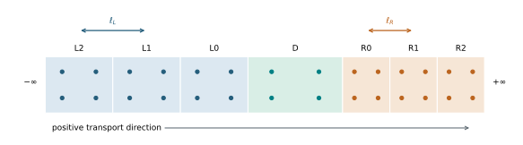
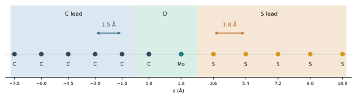
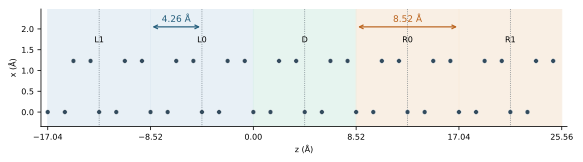
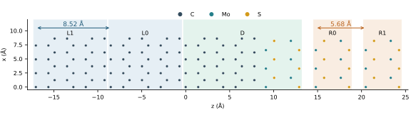
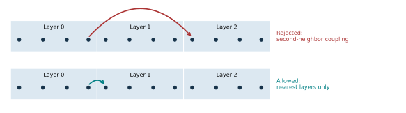
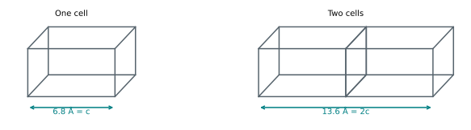

# How to define electrode repeat vectors — essential reading before transport

[Full illustrated PDF tutorial](PyYAeHMOP_v2_tutorial.pdf) · [All runnable examples](../examples/README.md) · [Device geometry](device-geometry.md)

The explicit two-terminal solver (.device.job) takes three finite geometry files: the nearest principal layer of the left lead, the scattering region and the nearest principal layer of the right lead. The leads themselves are semi-infinite. The repeat vectors are physical translations of the periodic electrodes, **not the contact gap, the distance between the first and last atoms, or arbitrary fitting parameters**.

## 1. What left_repeat and right_repeat mean

Let the supplied atomic positions be $\mathbf r_L^{(0)}$, $\mathbf r_D$ and $\mathbf r_R^{(0)}$. The repeated positions are

$$
\mathbf r_L^{(n)}=\mathbf r_L^{(0)}-n\mathbf a_L,\qquad
\mathbf r_R^{(n)}=\mathbf r_R^{(0)}+n\mathbf a_R,\qquad n=0,1,2,\ldots
$$

Here $\mathbf a_L$ and $\mathbf a_R$ are the Cartesian vectors in angstrom specified by left_repeat and right_repeat. Both have positive projection in the same transport direction. The solver uses the minus sign on the left automatically. The finite device is not repeated longitudinally.

For an electrode built from N consecutive bulk cells along a chosen longitudinal lattice vector $\mathbf c$,

$$
\boxed{\mathbf a_{\rm repeat}=N\mathbf c}.
$$

Choose N separately for each lead; the materials and longitudinal periods may differ. If the two leads are identical and have the same principal-layer construction, their repeat vectors are identical. The code expects all three supplied geometries already positioned in one common Cartesian frame; it does not align them automatically.

## 2. Simplest example: asymmetric one-dimensional chain

Folder: [examples/devices](../examples/devices/). Actual files: [chain_left.xyz](../examples/devices/chain_left.xyz), [chain_device.xyz](../examples/devices/chain_device.xyz), [chain_right.xyz](../examples/devices/chain_right.xyz). The left chain is C and the right chain is S; the device is C–Mo. This is an illustrative model, not a relaxed physical junction.

| File | Atom | x (Å) | y (Å) | z (Å) |
|---|---|---:|---:|---:|
| chain_left.xyz | C | 0 | 0 | -1.5 |
| chain_device.xyz | C | 0 | 0 | 0 |
| chain_device.xyz | Mo | 0 | 0 | 1.8 |
| chain_right.xyz | S | 0 | 0 | 3.6 |

The chosen periodic spacing in the C chain is 1.5 Å, and in the S chain it is 1.8 Å. Each principal layer contains one atom.

~~~ini
electrode_left = chain_left.xyz
scattering_region = chain_device.xyz
electrode_right = chain_right.xyz
left_repeat = 0 0 1.5
right_repeat = 0 0 1.8
cutoff = 2.0
~~~

There are no transverse periodic vectors.

| n | Left C z (Å) | Right S z (Å) |
|---:|---:|---:|
| 0 | -1.5 | 3.6 |
| 1 | -3.0 | 5.4 |
| 2 | -4.5 | 7.2 |
| 3 | -6.0 | 9.0 |
| 4 | -7.5 | 10.8 |

The spacing coincides with the nearest-neighbor distance only because the lead basis is monoatomic. In general the basis contains several atoms.

Run either [XYZ input](../examples/devices/asymmetric.device.job) or [CIF input](../examples/devices/asymmetric_cif.device.job), after activating the installed environment, from the checkout root:

~~~bash
cd examples/devices
python -m pyaehmop asymmetric.device.job --workers 2
python -m pyaehmop asymmetric_cif.device.job --workers 2
~~~

## 3. Graphene: why 8.52 Å and not 7.81 Å?

The four-carbon rectangular graphene cell in [graphene.xyz](../examples/transport/graphene.xyz) has the following basis:

~~~text
4
Rectangular graphene cell
C 0.000000 0 0.00
C 0.000000 0 1.42
C 1.229756 0 2.13
C 1.229756 0 3.55
~~~

Its transverse vector is (2.459512, 0, 0) Å and its longitudinal vector is (0, 0, 4.26) Å. Two longitudinal cells form an eight-carbon principal layer:

$$
\mathbf a_L=\mathbf a_R=2(0,0,4.26)=(0,0,8.52)\ {\rm Å}.
$$

Actual z coordinates (Å), in file order, are:

| [left.xyz](../examples/devices/left.xyz) | [pristine.xyz](../examples/devices/pristine.xyz) | [right.xyz](../examples/devices/right.xyz) |
|---:|---:|---:|
| -8.52 | 0.00 | 8.52 |
| -7.10 | 1.42 | 9.94 |
| -6.39 | 2.13 | 10.65 |
| -4.97 | 3.55 | 12.07 |
| -4.26 | 4.26 | 12.78 |
| -2.84 | 5.68 | 14.20 |
| -2.13 | 6.39 | 14.91 |
| -0.71 | 7.81 | 16.33 |

The extent of the left layer is $z_{\max}-z_{\min}=7.81$ Å, but the translation is 8.52 Å. The remaining projected separation to the next layer is 0.71 Å; it is not a C–C bond length because the last and next atoms have different x coordinates.

~~~ini
electrode_left = left.xyz
scattering_region = pristine.xyz
electrode_right = right.xyz
transverse_vectors = 2.459512 0 0
left_repeat = 0 0 8.52
right_repeat = 0 0 8.52
cutoff = 4.5
~~~

Run either [XYZ input](../examples/devices/pristine.device.job) or [CIF input](../examples/devices/pristine_cif.device.job):

~~~bash
cd examples/devices
python -m pyaehmop pristine.device.job --workers 4
python -m pyaehmop pristine_cif.device.job --workers 4
~~~

For a uniform crystal without a finite perturbation, the alternative .transport.job solver builds its principal layers automatically from the periodic cell.

## 4. Graphene–MoS2: why 5.679999661100459 Å?

The supplied [generator](../examples/devices/generate.py) constructs an illustrative commensurate lateral junction. Four graphene transverse repeats match three MoS2 transverse repeats. The MoS2 model is strained isotropically in-plane to match the width; it is not a relaxed or calibrated interface.

$$
W=4(2.459512)=9.838048\ {\rm Å},\qquad
a_{\rm MoS_2}=\frac{W}{3}=3.279349333\ldots\ {\rm Å}.
$$

The rectangular cell of the hexagonal lattice used by the generator has longitudinal period $\sqrt3\,a_{\rm MoS_2}$. The left principal layer contains two graphene cells along z; the right contains one rectangular MoS2 cell along z:

$$
L_L=2(4.26)=8.52\ {\rm Å},\qquad
L_R=\sqrt3\frac{9.838048}{3}=5.679999661100459\ {\rm Å}.
$$

The shared transverse supercell has 32 C atoms in L, 50 atoms in D (32 C + 6 Mo + 12 S) and 18 atoms in R (6 Mo + 12 S). A check with equivalent Mo sites at x=y=0 gives z=9.12 Å in D and z=14.799999661 Å in R, separated by the right repeat. This works because this part of D is an unmodified copy of the right lead, not because the repeat is determined from an arbitrary device–lead distance.

~~~ini
electrode_left = hetero_left.xyz
scattering_region = hetero_device.xyz
electrode_right = hetero_right.xyz
transverse_vectors = 9.838048 0 0
left_repeat = 0 0 8.52
right_repeat = 0 0 5.679999661100459
cutoff = 3.5
~~~

For other transverse multiples $m_g,m_m$ in this specific construction,

$$
W=m_g a_g,\quad a_m=W/m_m,\quad
L_L=N_L(4.26),\quad L_R=N_R\sqrt3\,a_m.
$$

These relations do not guarantee acceptable strain, relaxed geometry or energy alignment; reconstruct and validate the geometry whenever the multiples change.

Actual structures: [hetero_left.xyz](../examples/devices/hetero_left.xyz), [hetero_device.xyz](../examples/devices/hetero_device.xyz), [hetero_right.xyz](../examples/devices/hetero_right.xyz).

~~~bash
cd examples/devices
python -m pyaehmop graphene_mos2.device.job --workers 8
python -m pyaehmop graphene_mos2_cif.device.job --workers 8
~~~

[XYZ input](../examples/devices/graphene_mos2.device.job) · [CIF input](../examples/devices/graphene_mos2_cif.device.job).

## 5. Principal-layer thickness and cutoff: the exact solver checks

The current solver uses only neighboring principal-layer blocks. It must exclude second-neighbor lead interactions, device coupling to deeper lead layers and direct L–R coupling. The cutoff is a real-space distance in Å. The code uses conservative sufficient tests based on the projection onto the transport normal, not on bond lengths.

Let $\hat{\mathbf n}$ be the unit longitudinal normal (after removing the components in the common transverse lattice span), and define

$$
\ell_i=\mathbf a_i\cdot\hat{\mathbf n},\quad
p_i^{\min/\max}=\min/\max_{\alpha\in i}(\mathbf r_\alpha\cdot\hat{\mathbf n}),
\quad w_i=p_i^{\max}-p_i^{\min}.
$$

The atoms must be strictly ordered L, D, R in projected coordinate. Both repeats must have positive projection on the common normal. Define $g_L=p_D^{\min}-p_L^{\max}$ and $g_R=p_R^{\min}-p_D^{\max}$. For cutoff $r_c$, all five inequalities must hold:

$$
2\ell_L-w_L>r_c,\quad 2\ell_R-w_R>r_c,
$$

$$
g_L+\ell_L>r_c,\quad g_R+\ell_R>r_c,
\quad p_R^{\min}-p_L^{\max}>r_c.
$$

For the pristine graphene geometry: $\ell_L=\ell_R=8.52$ Å, $w_L=w_R=7.81$ Å, $g_L=g_R=0.71$ Å. The first four distances are 9.23 Å; the direct L–R projected separation is also 9.23 Å. Thus the supplied cutoff 4.5 Å passes, while 11 Å does not. With one cell per layer, the second-neighbor separation is 4.97 Å; it may pass at 4.5 Å if the other tests also pass. Two cells are the shipped construction, not a mathematical minimum for that cutoff.

| N longitudinal graphene cells | Atoms per layer (one transverse cell) | Repeat (Å) | Second-neighbor projected separation (Å) |
|---:|---:|---:|---:|
| 1 | 4 | 4.26 | 4.97 |
| 2 | 8 | 8.52 | 9.23 |
| 3 | 12 | 12.78 | 13.49 |
| 4 | 16 | 17.04 | 17.75 |
| 5 | 20 | 21.30 | 22.01 |

For cutoff 11 Å, three cells per lead satisfy the lead-only test, but the device must also be long enough. Rebuild the coordinates, contact buffers and repeat vectors together. Do not simply increase the repeat value while keeping an unchanged, shorter layer; that creates artificial gaps. The tests are conservative and passing them does not establish numerical convergence or physical accuracy. Converge the cutoff, overlap quadrature, k grid, eta and the contact buffer.

Implementation: [build_device in device_transport.py](../pyaehmop/device_transport.py).

## 6. Starting from a crystal CIF or XYZ

An orthogonal bulk CIF with a=3.20 Å, b=4.50 Å and c=6.80 Å has a longitudinal Cartesian vector (0,0,6.80) Å for transport along c. One cell gives repeat (0,0,6.80); two cells give (0,0,13.60). The latter requires twice the atoms, not just a different input number.

For a nonorthogonal bulk cell use the actual Cartesian components of the chosen lattice vector (or an appropriate integer supercell combination). Do not equate a lattice-vector length with a Cartesian z component unless the vector is aligned with z. Choose common transverse vectors so the two leads have the same positive longitudinal normal. For transport along x in graphene, for example, the supplied [graphene_x example](../examples/tutorials/graphene_x/) uses three cells and repeat (7.378536,0,0) Å, with transverse vector (0,0,4.26) Å.

1. Start with periodic bulk electrode structures (relaxed or otherwise justified) and their physical lattice vectors. For a molecule/chain model choose and justify a periodic motif and spacing.
2. Choose transport direction and a common transverse lattice (none for a 1D chain or ribbon; one for a 2D sheet; two for a 3D bulk lead).
3. Select principal-layer thickness for each electrode, build the corresponding atoms, and add contact buffers inside D. Assemble all positions in a single frame.
4. Export three XYZ files or three fully occupied ordered P1 CIF files in a common orthogonal coordinate-interchange box. In the latter case the box lengths are **not** physical repeat vectors; use the original bulk lattice. Never independently center or wrap the three regions.
5. Set repeat vectors, cutoff and other numerical/physical parameters. Check the five inequalities above, converge the model and validate the pristine reference before introducing defects or an interface.

An ordinary finite XYZ file does not store the bulk lattice vectors. The repeat cannot in general be inferred uniquely from its coordinates. The auxiliary CIF box also does not supply this missing physical information.

See [CIF/XYZ guide](transport-cif.md) and [all paired examples](../examples/README.md).
