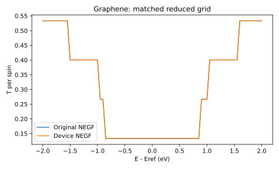
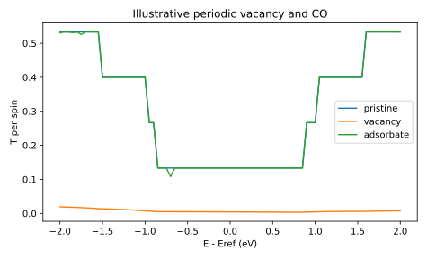
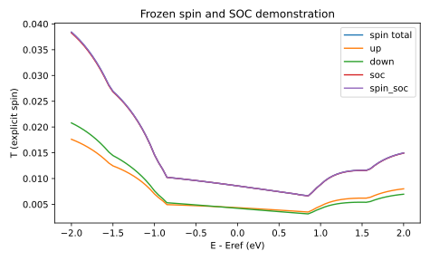
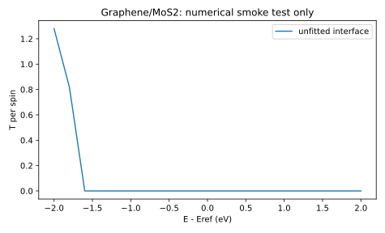

**[Complete paired XYZ/CIF input catalog](../README.md)** — all transport cases can now be run directly with either format.

# Version 2: independent two-terminal EHT-NEGF (experimental)

Version 2 preserves the original PyYAeHMOP engine and its existing input formats,
and adds a separate device solver for coherent elastic transport. The original
project is untouched. All tests and numerical calculations run outside GitHub.

## Run

    git clone https://github.com/tromer-unb/PyYAeHMOP_version2.git
    cd PyYAeHMOP_version2
    python -m venv .venv
    source .venv/bin/activate
    python -m pip install -e ".[all]"
    OPENBLAS_NUM_THREADS=1 OMP_NUM_THREADS=1 python -m pyaehmop examples/devices/pristine.device.job

On a PBS-enabled cluster, submit from the repository root:

    qsub -v PYTHON="$(command -v python)" examples/devices/validate.pbs

PBS is optional. On a workstation run the individual commands directly. Adapt resources and queue/account options to your scheduler.

## Geometry convention and input

Each XYZ file uses the SAME Cartesian frame (angstrom). Direct CIF jobs specify a common ordered P1 box and cif_origin metadata to recover that frame.
Left and right are the nearest principal layers, not isolated bulk cells
at arbitrary origins. Repeat vectors both point from left toward right.
The transverse lattice vectors are common to all three regions; omit them
for a 1D device. The lead repeats may have different lengths. The solver
rejects geometries when it cannot guarantee that the cutoff excludes
direct L-R coupling, second-neighbor lead layers or deeper lead-device
couplings. Enlarge principal layers and device buffer as necessary.

See [the illustrated geometry guide](../../docs/device-geometry.md), [parameter sources](../../docs/parameters.md), and [PDF tutorial](../../docs/PyYAeHMOP_v2_tutorial.pdf). Identical graphene leads have identical local geometry, not identical absolute XYZ coordinates. The left and right files are translations of pristine.xyz by -8.52 and +8.52 Å along z.

See pristine.device.job for all keys. The suffix .device.job selects
the new solver; the old .transport.job remains available.

- electrode_left, electrode_right, scattering_region: explicit XYZ or ordered P1 CIF.
- transverse_vectors: semicolon-separated Cartesian vectors; one mesh
  integer per vector in transverse_kpoints, blank for 1D.
- left_repeat/right_repeat: longitudinal principal-layer vectors.
- parameters: default or native YAeHMOP table; one common parameter set,
  default species fill any missing elements. K and weighted_hij control
  Hückel coupling. Use a validated common parameterization for interfaces.
- energy_reference_eV: explicit common energy zero (not automatic Fermi).
- cutoff and quadrature: overlap range and integration resolution.
- spin and soc: independently enabled; magnetic_parameters is JSON with
  left/device/right keys. Each region may specify offset_eV, exchange_eV
  (zero-based atom index -> shell letter -> I*m/2 in eV) and soc_eV
  (uppercase species -> shell -> xi in eV). Offsets are also usable without
  magnetic modes. Exchange and SOC are frozen onsite/overlap-symmetrized
  potentials, not a new open-system Stoner SCF. The original periodic SCF
  can be used to prepare exchange shifts separately. No charge transfer
  or electrostatic potential is solved automatically.
- calculations: transmission, conductance, iv. I(V) uses frozen T(E,0)
  and symmetric chemical potentials, not finite-bias self-consistency.
- spinless transmission is per spin; explicit spinors count both spins
  and use e^2/h, not 2e^2/h. For collinear spin, T_up and T_down and
  current_spin.dat are provided. With SOC, total transmission is reported;
  spin-projected channels are not yet implemented.

## Examples

All new structures and parameters are illustrative smoke-test models,
not physically relaxed or quantitatively fitted interfaces.
- pristine: graphene lead/device/lead; two rectangular cells per region.
- vacancy: one missing carbon; repeated every transverse period, NOT an
  isolated defect in an infinite sheet. Increase transverse cell size
  and converge defect separation, k mesh and device length.
- adsorbate: illustrative CO on graphene only in device, unrelaxed.
- spin, soc, spin_soc: vacancy model with illustrative frozen exchange/SOC.
- asymmetric: C/Mo/S chain tests dissimilar lead basis dimensions.
- graphene_mos2: illustrative lateral 4x graphene / 3x strained MoS2.
  Uses default Mo/S parameters, no interface fit or band alignment;
  do not interpret calculated curves as predictions of contact resistance.
- The new examples deliberately use reduced cutoff, quadrature and meshes
  to exercise the code. The original high-resolution graphene benchmark
  remains in ../transport.

## Theory

Rectangular interface H/S are computed using the same Slater overlap
engine as the bulk. For z=E+i eta, tau=z S_Da-H_Da, Sigma_a=tau_Da g_a
tau_aD; the reverse tau uses the SAME z (not its conjugate).
Surface Green functions are found with Lopez Sancho decimation;
G_D=(z S_D-H_D-Sigma_L-Sigma_R)^(-1). Transmission is the Caroli trace
Tr[Gamma_L G_D Gamma_R G_D^dagger], averaged over transverse k.
See ../transport/README.md for original references.

## Limitations

No self-consistent open-boundary spin/charge under bias, phonons,
inelastic scattering, noncollinear exchange, spin-resolved SOC transmission,
geometry optimization or GUI device builder. Validation is numerical,
not an independent DFT-NEGF benchmark for defects or MoS2. Test convergence
of overlaps, cutoff, eta, energy/k grids and principal layers before research.

## Research-cluster PBS validation (2026-11-26)

Source baseline: upstream PyYAeHMOP main commit
12ecadbbe8295a554004177d8d724434a95c8fca. All validation calculations ran on a research cluster,
never on GitHub Actions. PBS job 62853 (historical job ID) finished with Exit_status=0
in 48 s; 66 core tests ran (64 passed, 2 skipped), 17 spin tests passed.
The five device tests are included in the core count. Eight device jobs
and the pristine regression all reported exit=0. The earlier attempts
exposed SciPy/NumPy API compatibility issues, fixed in this repository.
Job 62854 produced compact archived spectra/plots in 2 s.

The original and generalized NEGF agree at the same reduced cutoff,
quadrature and mesh: mean absolute T difference 6.7954e-6, maximum
1.9770e-5, over 81 energy points. Small differences are expected from the
different device length at finite eta. This is not a new DFT comparison.
The original TranSIESTA benchmark is preserved in ../transport.

See [summary](benchmarks/summary.json) and the accompanying plain-text
transmission, conductance and current spectra. These are reduced-grid
engineering demonstrations, not converged physical predictions. In
particular the odd 15-point transverse mesh samples a nonzero near-Dirac
transmission at the specified energy reference; do not infer a finite
intrinsic Dirac-point conductance from this smoke test. The vacancy and CO
are repeated transversely, and the heterojunction parameters are not fitted
to a common interface DFT reference. The full original benchmark uses a
much denser mesh and a longer cutoff.

For a reproduction of these compact figures after the validation job:

    qsub -v PYTHON="$(command -v python)" examples/devices/archive.pbs

No GitHub workflows are included in Version 2.

## How to modify each example

All files have plain Cartesian XYZ positions in Å. In a pristine comparison use the same local basis/parameter table in all regions. Keep contact buffers and do not move the leads independently without rebuilding the interfaces.

| Input | What to change in a new model | What to keep fixed in a controlled comparison |
|---|---|---|
| pristine.device.job | Change lead thickness, transverse repeat or central length consistently | Same material and aligned contact layers |
| vacancy.device.job | Remove/relax the desired atom in the central XYZ | Pristine leads, transverse period and energy convention |
| adsorbate.device.job | Add a molecule only in D, using justified adsorption geometry and parameters | Pristine leads; compare the clean counterpart |
| asymmetric.device.job | Supply different lead XYZs and longitudinal repeats | Common transverse convention and contact positions |
| graphene_mos2.device.job | Build a commensurate relaxed interface; fit C/Mo/S and alignment | Shared transverse repeat and correct lead buffers |
| spin.device.job | Set spin=true; use exchange_eV by atom index and shell in magnetic.json | Preserve geometry; compare against nonmagnetic case |
| soc.device.job | Set soc=true; use soc_eV by species and shell | Same physical basis and geometry, spinor counting |
| spin_soc.device.job | Enable both; supply both calibrated frozen potentials | Same reference and numerical grids |

See the [geometry atlas](../../docs/device-geometry.md) and [illustrated PDF](../../docs/PyYAeHMOP_v2_tutorial.pdf) for actual coordinate plots, transmission, conductance and I(V) for every case.

## CIF alternatives for transport

[Direct CIF jobs and optional conversion](../../docs/transport-cif.md#3-explicit-devices-direct-xyz-and-cif-jobs) explains the paired uniform inputs and how to run all three-region CIF jobs directly (the optional converter is retained). The original XYZ examples remain unchanged.
