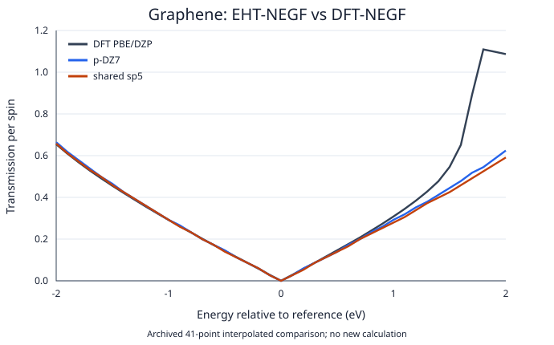
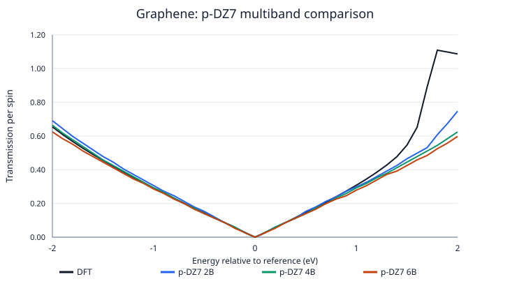
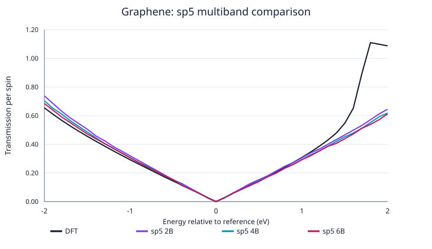
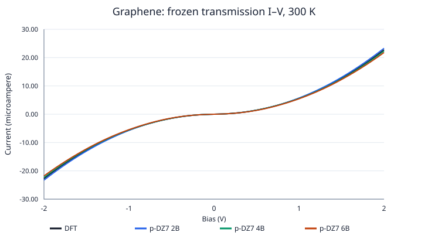

# Extended Hückel quantum transport (experimental)

The independent Python transport kernel uses the existing PyYAeHMOP real-space overlap and weighted Hückel Hamiltonian, retaining nonorthogonality. Principal-layer folding preserves all retained longitudinal couplings. Retarded surface Green functions are evaluated by iterative decimation; the Caroli trace uses energy-dependent couplings zS-H. Transmission is per spin, averaged over transverse k. No SIESTA, TBtrans, native YAeHMOP or DFT input is needed for prediction.

## Graphene example

The static [CSV](graphene_comparison.csv) contains 41 points sampled by linear interpolation from the existing LCCMat calculations (not new GitHub computations). DFT uses its reported energy reference, EHT uses its Dirac energy; a rigorous common alignment remains to be validated. The DFT endpoint values use nearest endpoint extension (original midpoint energy grid). The EHT runs used 301 transverse k points, 401 energies, eta=1e-5 eV, 11 Å cutoff, and 16 workers; DFT PBE/DZP used 1201 k points, 2000 energies, 300 Ry, zero bias. EHT uses a pristine rectangular four-carbon cell (16 orbitals), folded into a principal layer; DFT used an eight-carbon electrode and 32-carbon device. PBS jobs 62836 and 62837 generated the EHT data. The two methods agree closely near the Dirac point but differ above +1 eV, particularly above +1.5 eV. This is a preliminary benchmark, not a converged quantitative validation.

## Which bands were fitted?

Both frozen parameter sets were fitted to **two frontier bands (valence and conduction)**, not four, six or eight. The p-DZ7 C2DB PBE model has seven active parameters, trained on 37 nodes and evaluated at 361 nodes using interpolation of the same external reference, RMSE 0.32230993 eV. The shared sp5 PySCF/GTH-SZV PBE model has five parameters jointly fitted to two bands per material (graphene, T-graphene, net-C), graphene training RMSE 0.16831147 eV. The separate individual graphene sp5 fit (0.16569896 eV) is not the shared model used here. These RMSEs use different DFT references and must not be ranked directly. No transmission data was used to adjust these parameters. The full EHT Hamiltonian has four angular orbitals per atom; p-DZ7 contracts two radial p functions, not seven bands. The earlier independent SIESTA EHT-3 trial used four folded frontier bands and is not the model recommended here.

Frozen parameter provenance: [BandFit best results](https://github.com/tromer-unb/yaehmop-bandfit/blob/main/docs/BEST_RESULTS.md) and [metrics](https://github.com/tromer-unb/yaehmop-bandfit/blob/main/examples/best_results/metrics.json).

## Run locally (explicit opt-in)

From repository root, install with pip install -e ".[plots]" and run:

    OPENBLAS_NUM_THREADS=1 OMP_NUM_THREADS=1 python -m pyaehmop.graphene_transport --model pdz7 --nk 301 --ne 401 --workers 4 --output results/pdz7

Use --model sp5 for the shared parameters. Add --reference PATH for an optional aligned two-column DFT curve. No DFT reference is required. The static SVG is viewable without executing anything. The generic Python API is pyaehmop.transport.realspace, principal_layers, transmission and spectrum. Current scope: coherent, spin-degenerate, identical periodic leads and a pristine central principal layer. Defects, dissimilar leads, spin/SOC, finite-bias self-consistency and GUI integration are not implemented. No automatic CI or heavy runs are added.

## References

- R. Hoffmann, J. Chem. Phys. 39, 1397 (1963), https://doi.org/10.1063/1.1734456.
- M. P. López Sancho et al., J. Phys. F 15, 851 (1985), https://doi.org/10.1088/0305-4608/15/4/009.
- C. Caroli et al., J. Phys. C 4, 916 (1971), https://doi.org/10.1088/0022-3719/4/8/018.
- M. Brandbyge et al., Phys. Rev. B 65, 165401 (2002), https://doi.org/10.1103/PhysRevB.65.165401.
- N. Papior et al., Comput. Phys. Commun. 212, 8–24 (2017), https://doi.org/10.1016/j.cpc.2016.09.022.

## Matched 2-, 4- and 6-band calibration

Six additional fits use the same 338 SIESTA PBE/DZP k points, every fifth point held out, folded four-carbon EHT cell into the eight-carbon DFT electrode. BandFit differential evolution (180 evaluations per model) followed by SciPy least squares optimized the s onsite energy, K and energy alignment; p onsite, radial exponents and contraction coefficients were frozen. This is partial recalibration, not a new full sp5 or p-DZ7 optimization. Jobs 62838–62844 ran on LCCMat only. Transport used 301 transverse k points and 401 energies. See [parameters](multiband_parameters.json), [transmission data](multiband.csv).

| Model | Validation bands RMSE (eV) | T MAE ±2 eV | T MAE ±1 eV |
|---|---:|---:|---:|
| p-DZ7 2B | 0.180711 | 0.057506 | 0.005158 |
| p-DZ7 4B | 0.341156 | 0.061329 | 0.003914 |
| p-DZ7 6B | 0.483656 | 0.069337 | 0.006698 |
| sp5 2B | 0.206168 | 0.069681 | 0.008524 |
| sp5 4B | 0.282247 | 0.067725 | 0.006287 |
| sp5 6B | 0.330041 | 0.067169 | 0.006148 |

The four-band p-DZ7 has the smallest observed transmission MAE within ±1 eV (24.1% below the matched two-band fit); the two-band p-DZ7 has the smallest MAE over ±2 eV. The largest discrepancy is above +1.5 eV. All models were fitted only to bands, not to transmission. Band RMSE across different target counts is not directly comparable. MAE uses 41 common points (21 within ±1 eV); energy reference and k-grid convergence still need validation. The sp5 2B s energy reached its lower bound.

## Friendly job, installation and execution

    git clone https://github.com/tromer-unb/PyYAeHMOP.git
    cd PyYAeHMOP
    python -m venv .venv
    source .venv/bin/activate
    python -m pip install -e ".[all]"
    OPENBLAS_NUM_THREADS=1 OMP_NUM_THREADS=1 python -m pyaehmop examples/transport/graphene.transport.job --workers 4

The transport example is [graphene.transport.job](graphene.transport.job). Relative paths resolve against the job directory. For a periodic XYZ specify lattice vectors (semicolon-separated rows, Å), image bounds and zero-based transport lattice index; transverse mesh sizes follow remaining lattice axes. For CIF/ASE use a file with the intended periodicity (CIF normally sets 3D periodicity; use extended XYZ for 2D). Native YAeHMOP input also works. Supply an explicit absolute energy reference in eV, not an automatically inferred Fermi level. Only pristine identical periodic leads are supported. Parameters may be default or an external native YAeHMOP table. Other materials require validated parameters and suitable geometry.

Outputs: transmission.dat (per spin), transmission_k.npz, conductance.dat (S, zero temperature), current_voltage.dat (A), summary.json and optional PNGs. Existing bands/DOS remain available through ordinary .job files. No GitHub workflow runs on push.

## Current and conductance

[Archived I–V data](multiband_iv.csv) use symmetric chemical potentials ±V/2, 300 K and spin degeneracy two, integrated from the interpolated 41-point equilibrium transmission curves. These are illustrative Landauer postprocessing, not self-consistent finite-bias DFT or EHT simulations. The executable job integrates its full energy grid and checks bias/thermal coverage. G(E)=2e²/h T(E) at zero temperature. References: R. Landauer, IBM J. Res. Dev. 1, 223 (1957), https://doi.org/10.1147/rd.13.0223; M. Büttiker, Phys. Rev. Lett. 57, 1761 (1986), https://doi.org/10.1103/PhysRevLett.57.1761.
