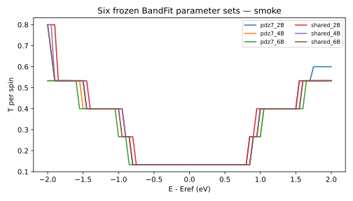

# Reproduce all six graphene BandFit calibrations and transport runs

The reference contains the six frontier bands of the original PBE/DZP
SIESTA electrode at 338 k points, relative to SIESTA E_F=-4.52664591 eV.
The original files contained 104 bands. The checked-in compact CSV
[frontier_bands.csv](reference/frontier_bands.csv) stores the reduced
wave vectors and six target energies; extract_reference.py can rebuild
it from elec.EIG and elec.KP. No DFT executable is needed to refit.

## Partial fit (the original protocol)

From the PyYAeHMOP_version2 root with the Python environment active:

    git clone https://github.com/tromer-unb/yaehmop-bandfit.git ../yaehmop-bandfit
    git -C ../yaehmop-bandfit checkout c4a7fa0326b04409bd5ba2b0556985b4e5e0e428
    OPENBLAS_NUM_THREADS=1 OMP_NUM_THREADS=1 python -m examples.tutorials.bandfit.refit --bandfit ../yaehmop-bandfit --workers 4

Or on LCCMat:

    qsub examples/tutorials/bandfit/refit.pbs

This uses the initial parameters in reference/, freezes radial exponents,
contraction coefficients and p onsite energies, optimizes s onsite, K and
energy alignment with BandFit differential evolution (seed 42, budget 180),
then SciPy least squares (max_nfev=80). Every fifth k point is held out.
The folded rectangular-cell eigenvalues are sorted before selecting 2, 4
or 6 bands. Each run writes per-k predicted/reference bands and fit
parameters to results/refit. This is not a full optimization of five or
seven radial/onsite parameters. The alignment is used only for the band fit;
transport uses the model's separately archived Dirac-energy reference.

PBS 62859 completed in 31 s. The six optimized Es, K and alignment values
match the original stored parameters exactly; see [refit results](reference/refit_summary.json)
and [differences](reference/refit_parameter_differences.json).

## Independent transport inputs (frozen fit parameters)

| Model | Native parameter file | Full 301 k × 401 E job | Quick 15 k × 81 E job |
|---|---|---|---|
| p-DZ7 2B | [parameters](pdz7_2B.dat) | [full](pdz7_2B.transport.job) | [quick](pdz7_2B_smoke.transport.job) |
| p-DZ7 4B | [parameters](pdz7_4B.dat) | [full](pdz7_4B.transport.job) | [quick](pdz7_4B_smoke.transport.job) |
| p-DZ7 6B | [parameters](pdz7_6B.dat) | [full](pdz7_6B.transport.job) | [quick](pdz7_6B_smoke.transport.job) |
| sp5 2B (shared) | [parameters](shared_2B.dat) | [full](shared_2B.transport.job) | [quick](shared_2B_smoke.transport.job) |
| sp5 4B (shared) | [parameters](shared_4B.dat) | [full](shared_4B.transport.job) | [quick](shared_4B_smoke.transport.job) |
| sp5 6B (shared) | [parameters](shared_6B.dat) | [full](shared_6B.transport.job) | [quick](shared_6B_smoke.transport.job) |

Run an individual example:

    python -m pyaehmop examples/tutorials/bandfit/pdz7_4B_smoke.transport.job --workers 4

Or submit PBS from repository root:

    qsub -v SUITE=bandfit examples/tutorials/run_suite.pbs
    qsub -v SUITE=full_bandfit examples/tutorials/run_suite.pbs

All six quick jobs passed PBS 62856. Compact [quick transmission](reference/smoke_transmission.csv),
[conductance](reference/smoke_conductance.csv) and [I(V)](reference/smoke_current_voltage.csv)
are archived. The full benchmark against TranSIESTA, including its numerical
comparison near E_F and the original plots, is in [transport](../../transport/README.md).
Quick-grid spectra are NOT the high-resolution benchmark.

