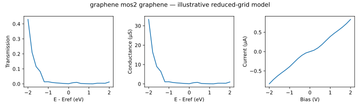

# Graphene Mos2 Graphene

A strained commensurate illustrative MoS2 channel between graphene contacts. The geometry is not relaxed; Mo/S parameters and interface band alignment are not calibrated.

Run from repository root:

    python -m pyaehmop examples/tutorials/graphene_mos2_graphene/run.device.job --workers 4

Inputs: [run.device.job](run.device.job), [left.xyz](left.xyz), [device.xyz](device.xyz), [right.xyz](right.xyz). Any magnetic/potential JSON is in this directory. The carbon parameters are in [carbon_pdz7_4B.dat](../../transport/carbon_pdz7_4B.dat).

Archived results: [transmission](reference/transmission.dat), [conductance](reference/conductance.dat), [current](reference/current_voltage.dat).

Reduced grid, frozen equilibrium transmission. See [tutorial overview](../README.md) for interpretation and limitations.
