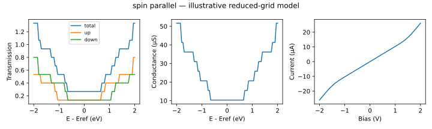

## Run with XYZ or CIF

[XYZ input](run.device.job) · [CIF input](run_cif.device.job) · [CIF geometries](cif_sources/run/)

```bash
python -m pyaehmop examples/tutorials/spin_parallel/run.device.job --workers 4
python -m pyaehmop examples/tutorials/spin_parallel/run_cif.device.job --workers 4
```

Both jobs use identical numerical settings and write separate results. The CIF box is for coordinate interchange only; the repeats in the input define the actual electrode periodicity.

# Spin Parallel

Illustrative frozen parallel collinear exchange on p shells in all three regions. Magnetic parameters are prescribed, not calibrated magnetic graphene.

Run from repository root:

    python -m pyaehmop examples/tutorials/spin_parallel/run.device.job --workers 4

Inputs: [run.device.job](run.device.job), [left.xyz](left.xyz), [device.xyz](device.xyz), [right.xyz](right.xyz). Any magnetic/potential JSON is in this directory. The carbon parameters are in [carbon_pdz7_4B.dat](../../transport/carbon_pdz7_4B.dat).

Archived results: [transmission](reference/transmission.dat), [conductance](reference/conductance.dat), [current](reference/current_voltage.dat).



Reduced grid, frozen equilibrium transmission. See [tutorial overview](../README.md) for interpretation and limitations.
